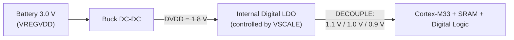

Ran find datasheet section lines
Analyzed efr32bg27_datasheet.md:L315-450
Analyzed efr32bg27_datasheet.md:L1050-1390
Analyzed efr32bg27_datasheet.md:L2070-2800
Analyzed efr32bg27_datasheet.md:L2801-3560
Analyzed efr32bg27_datasheet.md:L5975-6550
Analyzed efr32bg27_datasheet.md:L6551-7030
Edited power_manager_knowledge_map.md
Edited power_manager_knowledge_map.md
Edited power_manager_knowledge_map.md

I have extracted the exact electrical specifications from [efr32bg27_datasheet.md](file:///e:/STUDY/AI_Learning/Silabs_IoT/Label_project/firmwares/documents/docs/efr32bg27_datasheet.md) (Rev. 1.3) and cross-referenced them with [efr32xg27_rm_emu.md](file:///e:/STUDY/AI_Learning/Silabs_IoT/Label_project/firmwares/documents/docs/efr32xg27_rm_emu.md). All tables are saved in **§3.8** of [power_manager_knowledge_map.md](file:///C:/Users/sucut/.gemini/antigravity/brain/0f07d0d6-088c-47ff-ab09-651ee634f57b/power_manager_knowledge_map.md).

---

### 1. First: OPN & Hardware Resolution (Datasheet Table 2.1, [L320–L437](file:///e:/STUDY/AI_Learning/Silabs_IoT/Label_project/firmwares/documents/docs/efr32bg27_datasheet.md#L320-L437))
The ordering code `EFR32BG27C[f1][f2][f3]...` decodes `f1` = DC-DC type and `f2` = Max TX power:
- **Your `.slcp` (`EFR32BG27C140F768IM40-B`)**: `f1=1` (**Buck DC-DC**), `f2=4` (**+8 dBm PA**), 26 GPIOs, QFN40.
- **Research report (`EFR32BG27C320F768GJ39-B`)**: `f1=3` (**Buck or Boost DC-DC**), `f2=2` (**+4 dBm PA**), 19 GPIOs, WLCSP39.
- **Result:** Both chips support **Buck DC-DC** (3.0 V coin-cell input → 1.8 V internal) and **EM4** (by switching Buck to Bypass mode before EM4 entry).

---

### 2. MCU Current Consumption by Energy Mode (Tables 4.7–4.10, [L2080–L2798](file:///e:/STUDY/AI_Learning/Silabs_IoT/Label_project/firmwares/documents/docs/efr32bg27_datasheet.md#L2080-L2798))
Typical values at $T_A = 25\,^\circ\text{C}$:

| Energy Mode | Condition | **Buck DC-DC (3.0 V)** | **No DC-DC (3.0 V)** | **Boost DC-DC (1.5 V)** |
|---|---|---|---|---|
| **EM0** (Active) | 76.8 MHz DPLL, VSCALE2 (while / CoreMark) | **29 / 42 µA/MHz** (~2.23 / 3.23 mA) | 42 / 62 µA/MHz | 59 / 86 µA/MHz |
| **EM0** (Active) | 38.4 MHz HFXO, VSCALE1 (while / CoreMark) | **30 / 43 µA/MHz** (~1.15 / 1.65 mA) | 44 / 62 µA/MHz | 60 / 86 µA/MHz |
| **EM0** (Active) | 38 MHz HFRCO, VSCALE1 (while) | **25 µA/MHz** (~950 µA) | 36 µA/MHz | 50 µA/MHz |
| **EM1** (Sleep) | 76.8 MHz DPLL, VSCALE2 | **19 µA/MHz** (~1.46 mA) | 27 µA/MHz | 38 µA/MHz |
| **EM1** (Sleep) | 38.4 MHz HFXO, VSCALE1 | **20 µA/MHz** (~768 µA) | 30 µA/MHz | 41 µA/MHz |
| **EM1** (Sleep) | 38 MHz HFRCO, VSCALE1 | **16 µA/MHz** (~608 µA) | 22 µA/MHz | 31 µA/MHz |
| **EM2** (Deep Sleep) | VSCALE0, **Full 64 kB RAM** + RTC (LFXO/LFRCO) | **1.6 µA** | 2.2–2.3 µA | 3.1 µA |
| **EM2** (Deep Sleep) | VSCALE0, **24 kB RAM** + RTC (LFXO) | **1.4 µA** (1.8 µA LFRCO prec.) | 1.9 µA | 2.6 µA |
| **EM2** (Deep Sleep) | VSCALE0, **8 kB RAM** + RTC (LFXO) | **1.3 µA** (1.1 µA no RadioRAM/cache) | 1.7 µA (1.4 µA min) | 2.5 µA (2.1 µA min) |
| **EM3** (Stop) | VSCALE0, 8 kB RAM + RTC on ULFRCO | **1.1 µA** | 1.5 µA | 2.2 µA |
| **EM4** (Shutoff) | DC-DC in Bypass: No BURTC / With BURTC+LFXO | *(uses Bypass →)* | **0.18 µA / 0.51 µA** (0.14 / 0.43 µA @1.8V) | N/A (`BOOST_EN=0`: **10.4 nA**) |

---

### 3. Power Domain, RAM & Peripheral Current Costs ([L2219–L6910](file:///e:/STUDY/AI_Learning/Silabs_IoT/Label_project/firmwares/documents/docs/efr32bg27_datasheet.md#L2219-L2237))

| Hardware Block / Peripheral | Typical Current (3.0 V) | Engineering Note |
|---|---|---|
| **PD0B Domain Overhead (`I_PD0B_VS`)** | **+1.2 µA** (Buck) / **+1.7 µA** (No DCDC) | Added to EM2/3 just for keeping PD0B powered when *any* of `LETIMER0, IADC0, ACMP0, I2C0, WDOG0, EUSART0, PRS` is enabled ([L2219–L2224](file:///e:/STUDY/AI_Learning/Silabs_IoT/Label_project/firmwares/documents/docs/efr32bg27_datasheet.md#L2219-L2224)). Nearly **doubles** EM2 current (1.4 µA → 2.6 µA) before counting the peripheral itself! |
| **RAM Bank Retention (`I_RAM`)** | **0.043 µA** (8 kB) · **0.13 µA** (24 kB) · **0.17 µA** (32 kB) | Powering down unused RAM banks in EM2 saves ~0.3 µA. |
| **EM2 Debug (`EM2DBGEN = 1`)** | **+0.5 µA** | RM [L439](file:///e:/STUDY/AI_Learning/Silabs_IoT/Label_project/firmwares/documents/docs/efr32xg27_rm_emu.md#L439). Enabled by default in your `sl_power_manager_config.h`. |
| **HFXO (38.4 MHz)** | **415 µA** (startup **160 µs** typ) | Table 4.41 ([L6002](file:///e:/STUDY/AI_Learning/Silabs_IoT/Label_project/firmwares/documents/docs/efr32bg27_datasheet.md#L6002)). Why early wake & `min_offtime` matter! |
| **HFRCO** | **28 µA** (4 MHz) … **172 µA** (38 MHz) | Table 4.43 ([L6131](file:///e:/STUDY/AI_Learning/Silabs_IoT/Label_project/firmwares/documents/docs/efr32bg27_datasheet.md#L6131)). Startup **0.6–1.2 µs**. |
| **LFXO / LFRCO (32.768 kHz)** | LFXO: **254 nA** · LFRCO: **183 nA** (Normal), **664 nA** (Precision) | Tables 4.42, 4.45. LFRCO Precision mode turns on **PD0C** (+0.4 µA in EM2). |
| **IADC0** (PD0B) | **290 µA** (1 Msps active) · **16 µA** (Standby, 1 µs wake) | Table 4.49 ([L6520](file:///e:/STUDY/AI_Learning/Silabs_IoT/Label_project/firmwares/documents/docs/efr32bg27_datasheet.md#L6520)). Power-down wake is 5 µs. |
| **ACMP0** (PD0B) | **63 nA** (`BIAS=0`) to **47 µA** (`BIAS=7`) | Table 4.50 ([L6688](file:///e:/STUDY/AI_Learning/Silabs_IoT/Label_project/firmwares/documents/docs/efr32bg27_datasheet.md#L6688)). Continuous `VREFDIV` adds **3.2–7.0 µA** vs **~70 nA** in sample/hold. |
| **RFSENSE** (PDHV) | **138 nA** (131 nA OOK) | Table 4.16 ([L3508](file:///e:/STUDY/AI_Learning/Silabs_IoT/Label_project/firmwares/documents/docs/efr32bg27_datasheet.md#L3508)). Works even in EM4. |
| **Flash Write / Erase** | Write: **2.5 mA** max (44 µs/word) · Erase: **1.7 mA** max (13 ms/page) | Table 4.13 ([L3319](file:///e:/STUDY/AI_Learning/Silabs_IoT/Label_project/firmwares/documents/docs/efr32bg27_datasheet.md#L3319)). Blocks EM2 entry while active. |
| **GPIO Pull-up / Leakage** | Leakage: **2.5 nA** @25 °C · Pull resistor $R_{\text{PULL}} = \mathbf{44\,\text{k}\Omega}$ typ | Table 4.47 ([L6304](file:///e:/STUDY/AI_Learning/Silabs_IoT/Label_project/firmwares/documents/docs/efr32bg27_datasheet.md#L6304)). A pin with pull-up held low draws $3.0\,\text{V}/44\,\text{k}\Omega \approx \mathbf{68\,\mu\text{A}}$! |

---

### 4. BLE Radio Current vs. PHY & TX Power (dBm) (Tables 4.11 & 4.12, [L2813–L3293](file:///e:/STUDY/AI_Learning/Silabs_IoT/Label_project/firmwares/documents/docs/efr32bg27_datasheet.md#L2813-L3293))

| Radio Mode | PHY / PA Selection | **Buck 3.0 V — EM1P** *(Radio clocks only)* | **Buck 3.0 V — EM1** *(VSCALE1)* | **Buck 3.0 V — EM1** *(VSCALE2)* | **Boost 1.5 V — EM1P** |
|---|---|---|---|---|---|
| **RX Active / Listen** | **BLE 1M** (2GFSK) | **3.6 mA** | 3.8–3.9 mA | 4.0 mA | 7.5–7.6 mA |
| **RX Active / Listen** | **BLE 2M** (2GFSK) | **4.0–4.1 mA** | 4.3 mA | 4.5 mA | 8.4–8.6 mA |
| **RX Active / Listen** | **BLE Coded** (125k / 500k) | **3.8 mA** | 4.0–4.1 mA | 4.2–4.3 mA | 7.9–8.0 mA |
| **TX @ 0 dBm** | **0 dBm Low-Power PA** | **4.1 mA** | 4.3 mA | 4.5 mA | 8.2 mA |
| **TX @ 0 dBm** | High-Power PA *(wasteful at 0 dBm!)* | **5.8 mA** | 6.1 mA | 6.2 mA | 12.2 mA |
| **TX @ +4 dBm** | High-Power PA *(max on `C320`)* | **7.6 mA** | 7.9 mA | 8.0 mA | 15.9 mA |
| **TX @ +6 dBm** | High-Power PA *(max on `C230`)* | **9.2 mA** | 9.4 mA | 9.6 mA | 19.2 mA |
| **TX @ +8 dBm** | High-Power PA *(max on `C140`)* | **11.3 mA** | 11.5 mA | 11.7 mA | 23.4 mA |

**Three high-value design rules from this table:**
1. **EM1P saves 0.2–0.5 mA automatically during every radio packet** — *provided* your application does not hold an unnecessary `SL_POWER_MANAGER_EM1` requirement while the radio is transmitting/receiving! When you release `EM1`, the chip enters **EM1P** during radio events instead of full **EM1**.
2. **At 0 dBm, always select the 0 dBm Low-Power PA** (`4.1 mA`), not the High-Power PA (`5.8 mA`) — same RF output power, **1.7 mA less current**.
3. **BLE 2M PHY** draws slightly higher peak RX current (`4.0 mA` vs `3.6 mA`), but transmits/receives bits in **half the airtime**, cutting the energy per packet ($E = V \cdot I \cdot t$) nearly in half.

---

---

Both questions map directly back to our **Chunk 1 physics equation**:

$$P = \underbrace{\alpha \cdot C \cdot V^2 \cdot f}_{\text{dynamic power}} + \underbrace{V \cdot I_{\text{leak}}}_{\text{static leakage}}$$

---

### 1. Why are there two numbers: `while` loop vs. `CoreMark` (`29` vs. `42 µA/MHz`)?

Look at $\alpha \cdot C$ in the equation (**how many transistors flip on each clock tick**):

| Workload in Datasheet Table 4.7 | What the CPU & Memory are doing | $\alpha \cdot C$ (Switching Activity) | Current per MHz | Total @ 76.8 MHz (`× 76.8`) |
|---|---|---|---|---|
| **`while(1)` loop** | CPU repeats 1 tiny branch instruction already sitting in the **instruction cache**. Flash, RAM, multiplier, and bus matrix are mostly idle. | **Low** | **29 µA/MHz** | $29 \times 76.8 \approx \mathbf{2.23\,\text{mA}}$ |
| **`Prime` number calculation** | CPU ALU & registers do math, occasional memory access. | **Medium** | **32 µA/MHz** | $32 \times 76.8 \approx \mathbf{2.46\,\text{mA}}$ |
| **`CoreMark` benchmark** | Industry benchmark doing heavy list processing, matrix math, state machines, and constant **Flash + SRAM reads/writes**. | **High** (realistic busy code) | **42 µA/MHz** | $42 \times 76.8 \approx \mathbf{3.23\,\text{mA}}$ |

- **Why the datasheet gives `µA/MHz` and `mA`:**
  In EM0/EM1, current scales linearly with clock frequency $f$. The datasheet prints the normalized slope (`29 µA/MHz` or `42 µA/MHz`). Multiply by your clock frequency (`76.8 MHz`) to get total milliamps (`2.23 mA` vs. `3.23 mA`).
- **Rule of thumb for your project:** When estimating active current in EM0, use the **CoreMark** number (`42–43 µA/MHz`), because real firmware (BLE stack, packet parsing, display formatting) touches RAM and Flash like CoreMark, not an empty `while(1)` loop.

---

### 2. What is `VSCALE` (Voltage Scaling)?

Look at the **$V^2$** and **$V$** in the physics equation:
- Dynamic power scales with **$V^2$** (square of core voltage!).
- Static leakage scales with **$V$** (and rises even faster at low thresholds).

Inside the EFR32BG27 (RM [Figure 13.1](file:///e:/STUDY/AI_Learning/Silabs_IoT/Label_project/firmwares/documents/docs/efr32xg27_rm_emu.md#L89-L131) & [§13.3.5.1–13.3.5.2](file:///e:/STUDY/AI_Learning/Silabs_IoT/Label_project/firmwares/documents/docs/efr32xg27_rm_emu.md#L701-L737)), the Buck DC-DC outputs **1.8 V** (`DVDD`). Then an internal **Digital LDO** steps `1.8 V` down to a lower voltage on the **`DECOUPLE` pin** to feed the digital core and SRAM.

**`VSCALE` is the setting of that internal Digital LDO (`DECOUPLE` rail):**

| VSCALE Level | `DECOUPLE` Voltage (RM [L2591–L2597](file:///e:/STUDY/AI_Learning/Silabs_IoT/Label_project/firmwares/documents/docs/efr32xg27_rm_emu.md#L2591-L2597)) | Where it is used | Why / Trade-off |
|---|---|---|---|
| **`VSCALE2`** | **1.1 V** | **EM0 / EM1** when CPU clock **> 40 MHz** (up to 76.8 MHz). Default out of reset. | Transistors switch faster at higher voltage, needed for 76.8 MHz DPLL. |
| **`VSCALE1`** | **1.0 V** | **EM0 / EM1** when CPU clock **≤ 40 MHz** (e.g., 38.4 MHz HFXO). | $(1.0 / 1.1)^2 \approx 17\%$ less dynamic power than VSCALE2! |
| **`VSCALE0`** | **0.9 V** | **EM2 / EM3 Deep Sleep only** (CPU is off, only retaining RAM & LF logic). | Lowest possible leakage in EM2 (`1.6 µA`), **but** waking back up to EM0 must ramp `0.9 V → 1.1 V`, which costs **~50–64 µs** extra wake-up time! |

**How your SDK config controls this ([sl_power_manager_config.h](file:///e:/STUDY/AI_Learning/Silabs_IoT/Label_project/firmwares/config/sl_power_manager_config.h)):**
- `SL_POWER_MANAGER_ENABLE_EM01_VOLTAGE_SCALING`: if `1` and your clock is ≤ 40 MHz (like 38.4 MHz HFXO), the SDK drops EM0/EM1 from `VSCALE2 (1.1 V)` to `VSCALE1 (1.0 V)`.
- `SL_POWER_MANAGER_CONFIG_VOLTAGE_SCALING_FAST_WAKEUP` (or `sl_power_manager_em23_voltage_scaling_enable_fast_wakeup()`):
  - `0` (Low Power — your default): EM2 drops to **`VSCALE0 (0.9 V)`** → lowest sleep current (`1.6 µA`), +64 µs wake time.
  - `1` (Fast Wakeup): EM2 stays at `VSCALE2/1` → faster wake-up, higher EM2 sleep current.

---

